<div align="center">

<picture>
  <source media="(prefers-color-scheme: dark)" srcset="./assets/header-dark.svg">
  <source media="(prefers-color-scheme: light)" srcset="./assets/header-light.svg">
  
</picture>

<br/>

<a href="https://github.com/victorcorcovia">
  
</a>

<br/><br/>


<br/><br/>

<code><a href="#-sobre">./sobre</a></code> &nbsp;
<code><a href="#-competências">./competências</a></code> &nbsp;
<code><a href="#-stack">./stack</a></code> &nbsp;
<code><a href="#-contato">./contato</a></code>

</div>

<br/>

## `$` sobre

```ts
const victor = {
  role: "Desenvolvedor",

  trabalhando: {
    telefonia: ["Asterisk", "dialplan", "chamadas receptivas", "webhooks", "áudio com Polly"],
    painel:    ["Next.js", "React", "Tailwind", "tabelas e telas de uso"],
    qualidade: ["Vitest", "ESLint", "Sentry", "CI com GitHub Actions"],
  },

  construi: {
    ecommerce: ["Firebase (Firestore e Functions)", "Vite", "Cloudinary", "painel admin"],
    sites:     ["HTML", "CSS", "Firebase Hosting"],
  },

  dados:    ["MySQL", "Firestore"],
  sistemas: ["Linux", "Windows"],
  mindset:  "entender a operação → achar o gargalo → entregar algo que aguenta carga real",
};
```

> Do telefone ao navegador: ligações que entram, painéis que mostram o que aconteceu e lojas que vendem.

<br/>

## `$` competências

<table>
<tr>
<td width="33%" valign="top">

**`01` · Web & e-commerce**

```diff
+ Painéis em Next.js e React
+ Lojas virtuais e painel admin
+ Sites com HTML, CSS e Vite
+ TypeScript
```

</td>
<td width="33%" valign="top">

**`02` · Dados & infra**

```diff
+ MySQL
+ Firestore e regras de segurança
+ Firebase Functions e Hosting
+ Imagens com Cloudinary
+ Docker, Linux e Windows
```

</td>
<td width="33%" valign="top">

**`03` · Telefonia & qualidade**

```diff
+ Asterisk e dialplan
+ Chamadas receptivas e webhooks
+ Áudio com Polly
+ Vitest, ESLint, Sentry e CI
```

</td>
</tr>
</table>

<br/>

## `$` stack

<div align="center">


<br/>

<br/>


</div>

<details>
<summary><code>cat stack.yml</code></summary>

```yaml
linguagens:     [TypeScript, JavaScript, HTML, CSS]
frontend:       [React, Next.js, Vite, Tailwind CSS]
backend:        [Node.js, Firebase Functions]
dados:          [MySQL, Firestore]
telefonia:      [Asterisk, Polly]
qualidade:      [Vitest, ESLint, Sentry, GitHub Actions]
infraestrutura: [Linux (Arch), Windows, Docker, Firebase Hosting, Cloudinary]
ferramentas:    [Git, GitHub, VS Code]
```

</details>

<br/>

## `$` atividade

<div align="center">


</div>

<br/>

## `$` contato

<div align="center">

<a href="mailto:victor.corcovia@gmail.com"></a>

</div>
